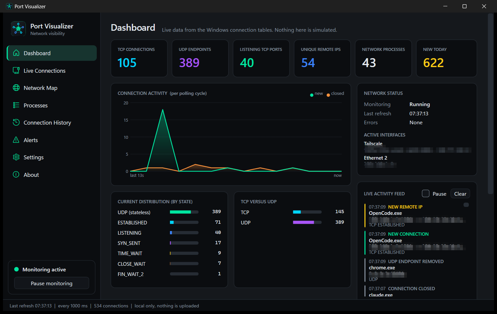
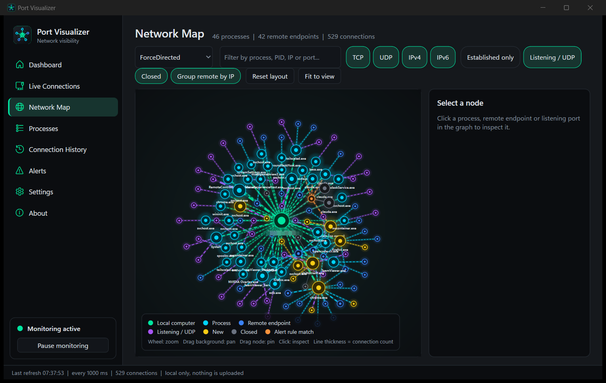

# Port Visualizer

**See what your computer is communicating with.**

Port Visualizer is a free, open-source Windows desktop app that shows every active TCP connection and UDP endpoint on your PC, tells you which process owns each one, and draws the whole picture as an interactive network map. It is a *defensive visibility tool*: it reads the Windows connection tables and nothing else.



## Features

- **Real-time monitoring** of TCP and UDP over IPv4 and IPv6 through the Windows IP Helper API (`GetExtendedTcpTable` / `GetExtendedUdpTable`), polled asynchronously at a configurable interval (500 ms to custom, default 1 s) with no overlapping cycles. UDP is shown honestly: Windows gives only the local endpoint, so no remote address is ever invented.
- **Process identification** with name, PID, executable path, start time, icon, publisher and Authenticode status. Identity is PID *plus* start time, so a reused PID is never confused with the old process. Access-denied, protected and vanished processes are handled gracefully.
- **Dashboard** with live statistic cards, connection activity chart, state and TCP/UDP distribution, top processes, top remote endpoints, active interfaces and a live activity feed (pausable).
- **Live Connections** table: search, sort, TCP/UDP/IPv4/IPv6/state filters, presets (built-in and your own), customisable columns, context menu (copy, open location, process info, related connections), virtualised for thousands of rows.
- **Interactive Network Map**: Computer -> Process -> Remote endpoint. Zoom, pan, drag nodes, hover tooltips, click for a details panel, highlighted paths, four layouts (force-directed, hierarchical, circular, grouped by process), animated lines, incremental updates, live filters, reset layout. Line thickness is the connection count (never bandwidth).
- **Change detection**: new/closed TCP connections, UDP endpoints, listening ports, TCP state changes, first-seen remote IPs and processes, with duplicate suppression.
- **Alerts** from rules *you* define: new listening port, new remote IP, new process, unexpected state, listed IPs/CIDR blocks, listed ports/ranges, monitored ports, process and IP whitelists, per-rule severity. Alerts never claim anything is malicious.
- **History** in a local SQLite database (changes only, never a snapshot per second) with search, date/process/IP/port/type filters, timeline, retention (1/7/30/90 days or unlimited) and automatic cleanup.
- **Export** to CSV, JSON or HTML: all, filtered or selected connections, history, process summaries.
- **System tray** with pause/resume, status and a visible active/paused badge. Light and dark themes, custom accent colour.
- **Private by design**: no packet capture, no credentials, no payloads, no stealth, no process killing, no firewall changes, no uploads. Works fully offline. Reverse DNS is opt-in and off by default.



## Install

Download **PortVisualizer_Setup.exe** (installer) or the portable **PortVisualizer.exe** from the [latest release](https://github.com/unupunct/Port-Visualizer/releases/latest). Windows 10/11 x64. No .NET runtime needed. No administrator rights needed.

Data (settings, SQLite history, logs) is stored in `%LOCALAPPDATA%\PortVisualizer`.

## Build from source

Requires the .NET 10 SDK (and Inno Setup 6 for the installer).

```powershell
dotnet test
dotnet publish src/PortVisualizer.App -c Release -r win-x64 --self-contained true -p:PublishSingleFile=true -o artifacts/publish
iscc installer\PortVisualizer.iss      # writes release\PortVisualizer_Setup.exe
```

Projects: `PortVisualizer.Core` (monitoring, diffing, filtering, alerts, graph, export), `PortVisualizer.Data` (SQLite), `PortVisualizer.App` (WPF/MVVM), `PortVisualizer.Tests` (xUnit).

## Permissions and limitations

- Runs as a normal user. Without administrator rights Windows hides the executable path of some protected processes; they are shown by name only. Optional "Restart as administrator" improves this.
- "No embedded signature" can still be a catalog-signed Windows file; catalog verification is not implemented.
- TIME_WAIT sockets are owned by PID 0 in Windows; Port Visualizer keeps the previously known owner when it saw the connection earlier.
- Monitoring happens only while the app (window or tray) is running; it does not start with Windows.
- The map caps very large graphs (4000 remote nodes) for responsiveness.
- Bandwidth is not measured, so it is never displayed.

## License

MIT. See [LICENSE](LICENSE).
